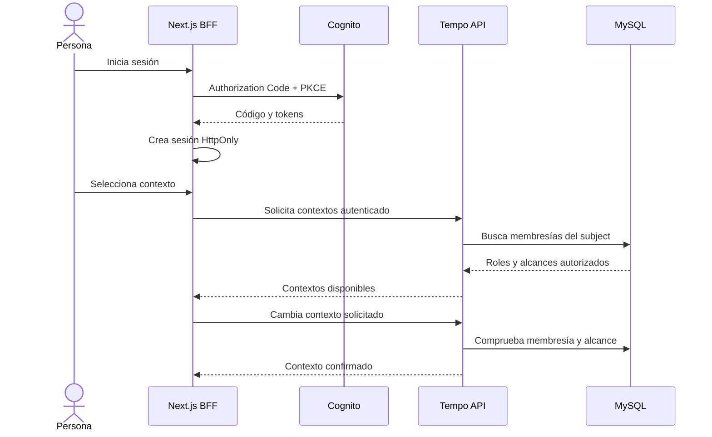

# Identidad y contextos de Tempo

## Componentes

- **Next.js BFF**: inicia Authorization Code + PKCE con Cognito, conserva los tokens en una cookie `HttpOnly` cifrada y retransmite las llamadas del navegador a la API como Bearer.
- **Spring Boot API**: valida el token presentado por el BFF, resuelve la identidad y aplica autorización y aislamiento por tenant en cada operación.
- **Cognito**: autentica personas. Los establecimientos, sucursales y roles de Tempo siguen siendo datos propios de la API.
- **MySQL/Flyway**: fuente de verdad de usuarios, tenants, sucursales, membresías, ajustes y auditoría.

## Contexto activo

El contexto elegido pertenece a una sesión autenticada del BFF. La API vuelve a comprobar que el usuario tenga esa membresía y el alcance de sucursal en cada solicitud. Nunca toma el tenant desde una ruta, parámetro de búsqueda o cuerpo de petición. Cambiar de contexto no equivale a conceder permisos ni invalida la comprobación por operación.

El BFF está implementado en `apps/web/app/api`: valida `state`, usa PKCE S256, intercambia y renueva tokens desde el servidor, cifra la sesión con AES-256-GCM y elimina la cookie al salir. El proxy limita las solicitudes a `/api/v1`, pasa el access token como Bearer y comprueba el origen en métodos que pueden cambiar datos. No se envían tokens al navegador ni a `localStorage`.

Para habilitar Cognito hace falta crear el User Pool/App Client, registrar callback y sign-out URLs y completar las variables de `apps/web/.env.local`. La API valida el JWT de Cognito cuando `COGNITO_ISSUER_URI` y `COGNITO_CLIENT_ID` están configurados; sin ellos, las rutas protegidas fallan cerradas. Los endpoints de contexto, el alta/sincronización de usuarios y MFA de superadministración siguen pendientes, por lo que aún no hay flujo integral de usuario real.
